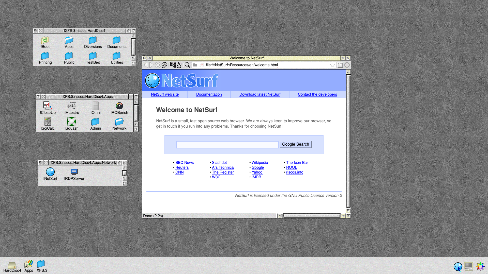
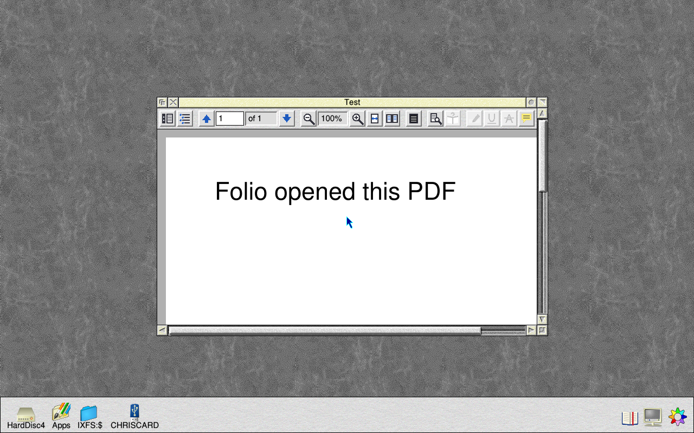

# RISC OS on Linux 1.0.0018 (5 November 2026): public test release

RISC OS 5.31 (RISC OS 5.31-17: RISC OS Open's nightly in Timothy
Baldwin's Linux port) on Debian 13, for 64-bit ARM machines. This is a
test release: it runs well on the machines below, but please report
anything that doesn't work.

## The images

| Image | For | File |
|---|---|---|
| Generic | Raspberry Pi 3/3B+/CM3, Zero 2 W, 4/400/CM4, 5/500/CM5; UEFI machines (QEMU, ARM boards and servers); Pinebook and Pinebook Pro | `riscos-generic.img.xz` |
| UTM | Apple Silicon Macs | `RISC OS 1.0.0018.utm` (in `RISC OS 1.0.0018.utm.zip`) |
| Windows Dev Kit 2023 | Snapdragon 8cx Gen 3 ("Project Volterra") only | `riscos-wdk2023.img.xz` |

Write the .img.xz to a card or USB disc with Raspberry Pi Imager ("Use
custom") or balenaEtcher. Unzip the .utm and double-click it to add it to
UTM. Each image starts straight into the RISC OS desktop; Shutdown powers
the machine off. `SHA256SUMS` lists the files' checksums.

The Dev Kit image is only for the Dev Kit: its kernel loads the Dev Kit's
own device tree, so anywhere else (UTM, QEMU, a Pi) Linux finds no screen
and the machine switches off a minute later. Use the generic image or the
.utm for those.

Already running 1.0.0006 or later? Configure → Updates brings you to the
same versions without reinstalling. **On UTM, see "If RISC OS doesn't
start on UTM" below first.**

## What's new since 1.0.0017

- **Folio, the PDF and ebook reader,** comes with it, in Apps.Document
  (installed as PackMan installs it, so PackMan upgrades it), and **PDF
  files open in Folio** when double-clicked. Folio also reads EPUB, FB2,
  MOBI, CBZ and XPS (drag them to its icon). It needs a screen mode of 32
  thousand colours or more. To use another PDF viewer, delete
  !Boot.Choices.Boot.Tasks.FolioPDF.

  

- **Faster under QEMU** (UTM on an Apple Silicon Mac): NEON's integer
  instructions run as the Mac's own vector instructions (image and video
  work 1.6 to 4.5 times as fast in ROBench), and jumps between translated
  code are found faster (SWIs about 1.25 times as fast, video decoding
  about 20% faster). A Raspberry Pi runs RISC OS natively and doesn't use
  QEMU.
- **GPIO on a Raspberry Pi 3 or 4:** RISC OS has the Pi's GPIO devices,
  working on the board's own GPIO registers through Linux. Programs that
  drive the GPIO pins work, and so does the Raspberry Pi edition of ROOL's
  DDE: its C compiler and assembler run, and RISC OS itself has been built
  with it on RISC OS on Linux on a Pi 4.
- **Saving from StrongEd 4.70:** HardDisc4, USB discs and SD cards have a
  disc name, ROL (`IXFS::ROL.$.…`), which StrongEd needs to save.
- **IXFS:$** is on the icon bar, labelled IXFS:$, next to Apps.
- **Updates** shows what it's doing while it installs (the time so far,
  and apt's progress), and Install updates no longer stops with "String
  too long at line 445" once the root password has been given.
- The drive icons start from their own boot file, so a replacement
  pinboard (ROD's Pinboard2) keeps them.

The full list is in Configure → Updates → Changes, and in
[riscos-rolpkg's CHANGELOG](https://github.com/adyoull/riscos-rolpkg/blob/main/CHANGELOG.md).

## If RISC OS doesn't start on UTM

RISC OS 5.31-16 and 5.31-17, from Updates on 4 November, were installed
so that only root could read them. Natively (a Pi, the Dev Kit) that
didn't matter, but under QEMU RISC OS stopped at once: the start-up
screen showed, and the machine switched off a minute later. RISC OS
5.31-17.1 (in this release, and in Updates) fixes it.

A UTM machine that already has 5.31-16 or 5.31-17 can't start RISC OS to
run Updates. Start again from this release's `RISC OS 1.0.0018.utm`. If
you have files on the old one, keep it and ask; they can be copied out.

## Versions in this release

| Package | Version |
|---|---|
| RISC OS (`riscos-rom`) | 5.31-17.1 |
| The Linux side (`riscos-support`) | 1.0.0026-1 |
| The desktop parts (`riscos-harddisc`) | 1.0.0033-1 |
| Kernels | Pi 6.6.78-5; generic and Dev Kit 7.2.0-3 |

## Tested

| Machine | |
|---|---|
| Raspberry Pi 4 | Andrew Youll: GPIO, and the Raspberry Pi DDE (RISC OS built with it) |
| Raspberry Pi 5 | Chris Gransden (1.0.0017) |
| Windows Dev Kit 2023 | Chris Gransden (1.0.0017) |
| UTM on an Apple Silicon Mac | this release's QEMU in a Linux VM on an Apple Silicon Mac; this disc in QEMU with QEMU forced, as on UTM |
| QEMU (UEFI, and the Dev Kit's kernel) | this disc: the desktop, Folio opening a PDF, *IXRun |
| Raspberry Pi 3, Zero 2 W | untried |
| Pinebook, Pinebook Pro | untried: treat as experimental |

**Thank you to Chris Gransden** for his testing and reports: the UTM
start-up problem and the Updates error fixed in this release were his
finds.

## Known issues

- The Filer can stop with an abort in the kernel's sprite plotting when
  opening certain directories (seen with !RiscOSM's).
- On a Raspberry Pi, ROBench's BPut/BGet tests fail to open their file.
- Discs inside the machine in RISC OS's own format (FileCore on an
  internal SSD or NVMe) aren't offered to RISC OS; USB discs and SD cards
  are.
- Socket_Connect can report success for a connection that was refused.
- Iris isn't included: get it from riscosdev.com or PackMan (1.029 is the
  latest that runs properly on RISC OS on Linux).

Please send reports with the `LOGS` folder from the FAT partition.

## Source and licences

All the source is at [riscos-linux](https://github.com/adyoull/riscos-linux)
(RISC OS 5.31-17 on the `riscos-5.31-source` branch). Each image carries
`SOURCE.txt` and a `LICENCES` folder on its FAT partition, and
HardDisc4.Documents.Licences and .Source.

Copyright (c) 2026 Andrew Youll. MIT licence (see LICENSE).
