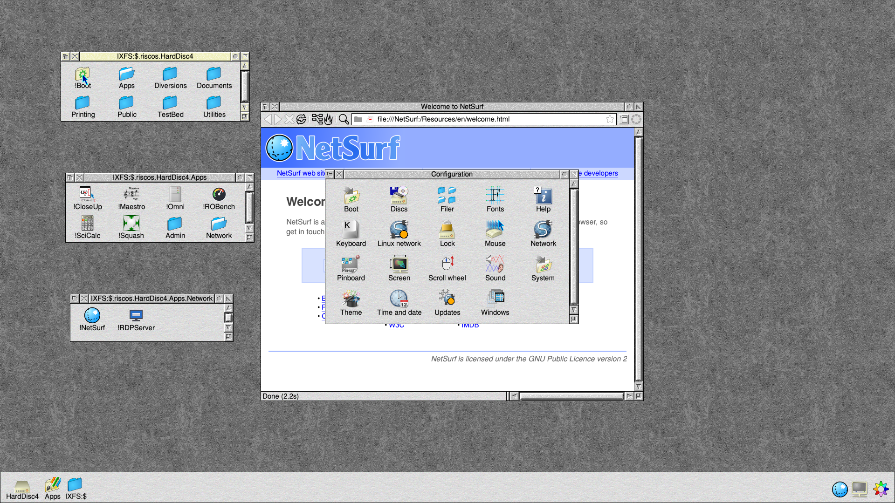
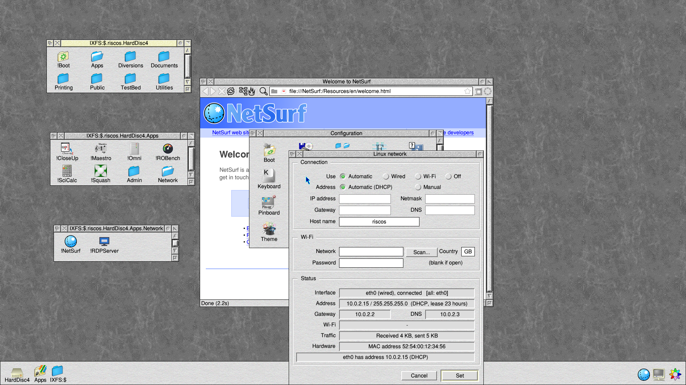
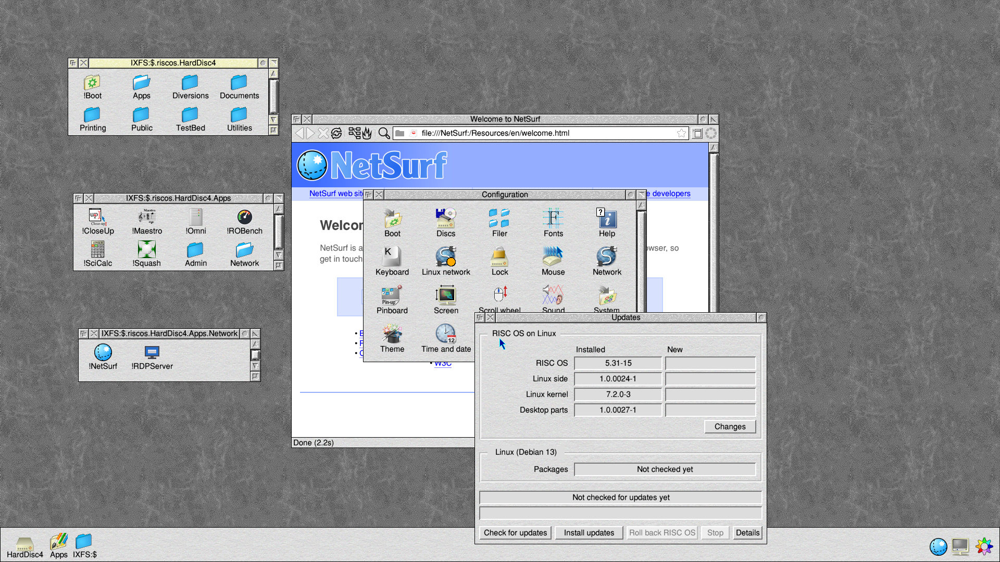

# RISC OS on Linux 1.0.0017 (4 November 2026): public test release

RISC OS 5.31 (RISC OS 5.31-15: RISC OS Open's nightly in Timothy
Baldwin's Linux port) on Debian 13, for 64-bit ARM machines. This is a
test release: it runs well on the machines below, but please report
anything that doesn't work.

## The images

| Image | For | File |
|---|---|---|
| Generic | Raspberry Pi 3/3B+/CM3, Zero 2 W, 4/400/CM4, 5/500/CM5; UEFI machines (QEMU, ARM boards and servers); Pinebook and Pinebook Pro | `riscos-generic.img.xz` |
| UTM | Apple Silicon Macs | `RISC OS 1.0.0017.utm` (in `RISC OS 1.0.0017.utm.zip`) |
| Windows Dev Kit 2023 | Snapdragon 8cx Gen 3 ("Project Volterra") | `riscos-wdk2023.img.xz` |

Write the .img.xz to a card or USB disc with Raspberry Pi Imager ("Use
custom") or balenaEtcher. Unzip the .utm and double-click it to add it to
UTM. Each image starts straight into the RISC OS desktop; Shutdown powers
the machine off. `SHA256SUMS` lists the files' checksums.

Already running 1.0.0006 or later? Configure → Updates brings you to the
same versions without reinstalling.

## What's new since 1.0.0006

- **Faster:** on a processor that runs 32-bit ARM code (a Pi, the Dev
  Kit), RISC OS runs natively; SWIs are now about three times faster on a
  Raspberry Pi 4 (a kernel fast path), and programs that used to stop
  through Linux on every return to user mode (RiscOSM's map drawing) no
  longer do.
- **USB discs and SD cards:** FAT, exFAT, NTFS and ext discs appear on the
  icon bar when plugged in, by their volume names; discs in RISC OS's own
  format (FileCore) appear as `SCSI::` drives, as on a native Pi, and HForm
  can format them. A machine's own SD slot works the same way. Ejecting
  closes the disc's windows; pulling a disc out does too. Files get the
  type of their extension (a `photo/jpg` is a JPEG).
- **Files over 2GB** on HardDisc4 and USB discs (up to RISC OS's 4GB − 1).
- **Video in hardware on the Raspberry Pi 3 and 4:** H.264 decoding by the
  VideoCore for Reel, Matinee and FFmpeg, shown on the display's video
  plane without tearing. (The Pi 5 has no H.264 decoder in hardware; it,
  and other machines, decode in software.)
- **Networking:** !Omni (LanManFS, Access) works; servers see their
  clients' first data (RDPServer); closed connections are seen at once;
  socket options for GLib programs; NetStats and InetStat work.
- **Linux commands:** `*IXRun` runs a Linux command as RISC OS's own Linux
  user (no password, no privileges), by name (`*IXRun ls -l`); `*Linux`
  still runs them as root after asking for the root password.
- **Updates** has a Changes button: what each newer version changes,
  before you install it.
- **Included apps:** NetSurf 3.11 and RDPServer 0.2 (in Apps.Network, where
  PackMan puts them), PDFS 0.16.2 beta (TestBed.PDFS), ROBench, and !Omni.
- **Finer timing** for programs (sub-centisecond clocks: games, SDL), and
  the keyboard's LEDs follow RISC OS.
- RISC OS errors from HardDisc4 instead of Linux's ("This item is locked"),
  editors that check the free space can save there (StrongEd), all the RAM
  Linux can give (up to 4GB), restart restarts, and the boot partition is
  always left clean.

The full list is in Configure → Updates → Changes, and in
[riscos-rolpkg's CHANGELOG](https://github.com/adyoull/riscos-rolpkg/blob/main/CHANGELOG.md).

## Versions in this release

| Package | Version |
|---|---|
| RISC OS (`riscos-rom`) | 5.31-15 |
| The Linux side (`riscos-support`) | 1.0.0024-1 |
| The desktop parts (`riscos-harddisc`) | 1.0.0027-1 |
| Kernels | Pi 6.6.78-4; generic and Dev Kit 7.2.0-3 |

## Tested

| Machine | |
|---|---|
| Raspberry Pi 4 | Andrew Youll, including H.264 video in hardware |
| Raspberry Pi 5 | Chris Gransden |
| Windows Dev Kit 2023 | Chris Gransden |
| UTM on an Apple Silicon Mac | earlier builds; this disc in QEMU |
| QEMU (UEFI, and the Dev Kit's kernel) | every build, with the test suite |
| Raspberry Pi 3, Zero 2 W | untried |
| Pinebook, Pinebook Pro | untried: treat as experimental |

**Thank you to Chris Gransden** for his testing on the Windows Dev Kit
2023 and the Raspberry Pi 5, and for his clear, detailed reports: many of
the fixes in this release started with them.

## Known issues

- The Filer can stop with an abort in the kernel's sprite plotting when
  opening certain directories (seen with !RiscOSM's).
- On a Raspberry Pi, ROBench's BPut/BGet tests fail to open their file.
- Discs inside the machine in RISC OS's own format (FileCore on an
  internal SSD or NVMe) aren't offered to RISC OS; USB discs and SD cards
  are.
- Socket_Connect can report success for a connection that was refused.
- Iris isn't included: get it from riscosdev.com or PackMan (1.029 is the
  latest that runs properly on RISC OS on Linux).

Please send reports with the `LOGS` folder from the FAT partition.

## Source and licences

All the source is at [riscos-linux](https://github.com/adyoull/riscos-linux)
(RISC OS 5.31-15 on the `riscos-5.31-source` branch). Each image carries
`SOURCE.txt` and a `LICENCES` folder on its FAT partition, and
HardDisc4.Documents.Licences and .Source.

Copyright (c) 2026 Andrew Youll. MIT licence (see LICENSE).

---

# RISC OS on Linux 1.0.0006 (31 October 2026)

The first release: version 1.0, build 0006.

RISC OS 5.31 (RISC OS Open's nightly of 29 October 2026, in Timothy
Baldwin's Linux port) on Debian 13, for 64-bit ARM machines.

## The images

| Image | For | File |
|---|---|---|
| Generic | Raspberry Pi 3/3B+/CM3, Zero 2 W, 4/400/CM4, 5/500/CM5; UEFI machines (UTM, QEMU, ARM boards and servers); Pinebook and Pinebook Pro | `riscos-generic.img.xz` |
| UTM | Apple Silicon Macs | `RISC OS 1.0.0006.utm` |
| Windows Dev Kit 2023 | Snapdragon 8cx Gen 3 ("Project Volterra") | `riscos-wdk2023.img.xz` |

Write the .img.xz to a card or USB disc with Raspberry Pi Imager ("Use
custom") or balenaEtcher. Double-click the .utm to add it to UTM. Each
image starts straight into the RISC OS desktop. Shutdown powers the
machine off.

## What's in it

- **Updates for RISC OS itself.** Configure → Updates checks for and
  installs new builds of RISC OS, its Linux side, the machine's kernel and
  the desktop parts (packages from
  [riscos-rolpkg](https://github.com/adyoull/riscos-rolpkg)), and Debian's
  own updates. Roll back RISC OS returns to the build before. If a new
  RISC OS won't start, an empty file called `ROLLBACK` on the FAT partition
  puts the old one back.
- **Debian 13 underneath** (minimal, no desktop), kept up to date by Updates.
- **Protected RISC OS.** RISC OS runs as an ordinary Linux user and sees
  only its own files. `*Linux` runs Linux commands as root after asking for
  Linux's root password: you choose one the first time, `*LinuxPassword`
  changes it, and an empty file called `RESETPW` on the FAT partition
  clears it if it's forgotten.
- **USB for RISC OS programs.** USBDriver gives RISC OS programs the USB
  devices Linux has no driver for (phones, cameras), so PDFS works.
- **HardDisc4 as a hard disc icon**, with RISC OS's own Free window and
  drag-to-copy.
- **The screen mode** starts at the screen's own size. A mode chosen and
  set in Configure → Screen is kept.
- **Scroll wheel direction.** Configure → Scroll wheel offers Normal or
  Reversed ("natural", as on a Mac).
- **PackMan** comes set up with
  [riscos-packages](https://github.com/adyoull/riscos-packages) and
  riscosdev.com's autobuilt list as well as RISC OS Open's lists, and
  with root certificates for secure downloads.
- **The version** (Task manager → Info, `*Fx 0`) says the nightly's date:
  "RISC OS 5.31 (29 Oct 2026) nightly".
- **Wi-Fi:** Raspberry Pi 4/5/500/CM4/CM5, Pinebook and Pinebook Pro
  (Configure → Linux network).
- **A start-up screen** says what's happening: the disc being enlarged
  on the first start, the network, the clock, RISC OS starting, and when
  RISC OS ends, Linux saving and switching off.
- **The right time:** Linux sets the clock by NTP as soon as the network
  is up, and every hour; RISC OS reads Linux's clock. A Pi keeps the time
  on its card between starts, so it never starts in 1970 (which made
  secure downloads fail).
- **Name servers that follow the network:** a link or Wi-Fi that comes up
  after the desktop still works in RISC OS (NetWatch).
- **The whole disc:** the Linux partition grows to fill a bigger card or
  disc at the next start (an empty `NOGROW` file on the FAT partition
  stops it).
- **Logs you can read anywhere:** the start-up logs are copied to `LOGS`
  on the FAT partition, for a machine whose screen stays dark.
- **In UTM**, only RISC OS's pointer shows (UTM's own arrow is hidden).
- **Included:** ROBench, PDFS 0.16 beta, the VideoCore stand-ins, PackMan,
  and GCCSDK's UnixLib modules. Iris isn't included: get it from
  riscosdev.com or PackMan.

## Tested

In QEMU (UEFI, and the Dev Kit's kernel): booting to the desktop, Updates
(against a signed local copy of the repository, over https), Roll back and
ROLLBACK, the root password, USB with QEMU's MTP device (PDFS), the screen
mode, the Scroll wheel option and PackMan's set-up. The UTM image is used
on an Apple Silicon Mac.

**Not yet tried on real hardware:**

| Machine | Status |
|---|---|
| Raspberry Pi 4 | starts and runs; the screen fixed in 1.0.0003 (its HDMI driver was waiting for a missing part) |
| Raspberry Pi 3, 5 | untried |
| Pinebook, Pinebook Pro | untried; treat as beta |
| Windows Dev Kit 2023 | untried; treat as beta |

Wi-Fi and PDFS with a real phone are untried on all of them. Please
report what works.

## Since 1.0.0006 (through Updates)

These come through Configure → Updates; the next images will have them.

| Package | What changed |
|---|---|
| RISC OS `5.31-2` | The RAM Linux can give RISC OS (up to 4GB) instead of a fixed figure, and the Task Manager's free memory from it; network statistics for programs that read them the old way (Internet 5's Socket_Sysctl, Socket_InternalLookup, and InetStat's connections and `-s`), so NetStats works; the version reads "RISC OS 5.31-2 (29 Oct 2026)" |
| RISC OS `5.31-3` | Proper RISC OS errors from HardDisc4 ("The disc has no more available space", "This item is locked...", "This file is already open"...) instead of Linux's names, the Locked attribute obeyed, and delete failures no longer lost; physical memory pool areas (for GCCSDK's ARMEABISupport 1.08) done by the kernel itself. Known gaps, for the next build: a locked file can still be renamed, and OPENOUT on a locked file empties it (RISC OS's FileSwitch asks the filing system to open it for update, so it can't tell) |
| `riscos-support 1.0.0008-1` | `/dev/pts` mounted (apt could not write its log) |
| `riscos-support 1.0.0009-1` | Restart (Ctrl+Break, the Shutdown box's Restart, `*Reset`) restarts the machine instead of switching it off |
| `riscos-support 1.0.0011-1` | The screen: only what changed is redrawn, and moving the pointer doesn't redraw the screen |
| `riscos-harddisc 1.0.0007-1` to `1.0.0010-1` | LinuxCodec 0.03 (the Raspberry Pi's H.264 decoder, multi-planar; whole pictures to the decoder, which had turned split pictures green), loaded at start-up |

## Version numbers

Each release is 1.0.<build>. In
[riscos-rolpkg](https://github.com/adyoull/riscos-rolpkg), RISC OS, its
Linux side and the desktop parts carry the build they came from
(`1.0.0004-1`); RISC OS itself and the kernels keep their own versions
with a build count after the hyphen (RISC OS `5.31-2`, shown as "RISC OS
5.31-2 (29 Oct 2026)" from its next build; the Pi's kernel `6.6.78-2`, the
others' `7.2.0-1`). The modules keep their own versions.

## Source and licences

All the source is at [riscos-linux](https://github.com/adyoull/riscos-linux)
(RISC OS 5.31 on the `riscos-5.31-source` branch). Each image carries
`SOURCE.txt` and a `LICENCES` folder on its FAT partition, and
HardDisc4.Documents.Licences.

Copyright (c) 2026 Andrew Youll. MIT licence (see LICENSE).
